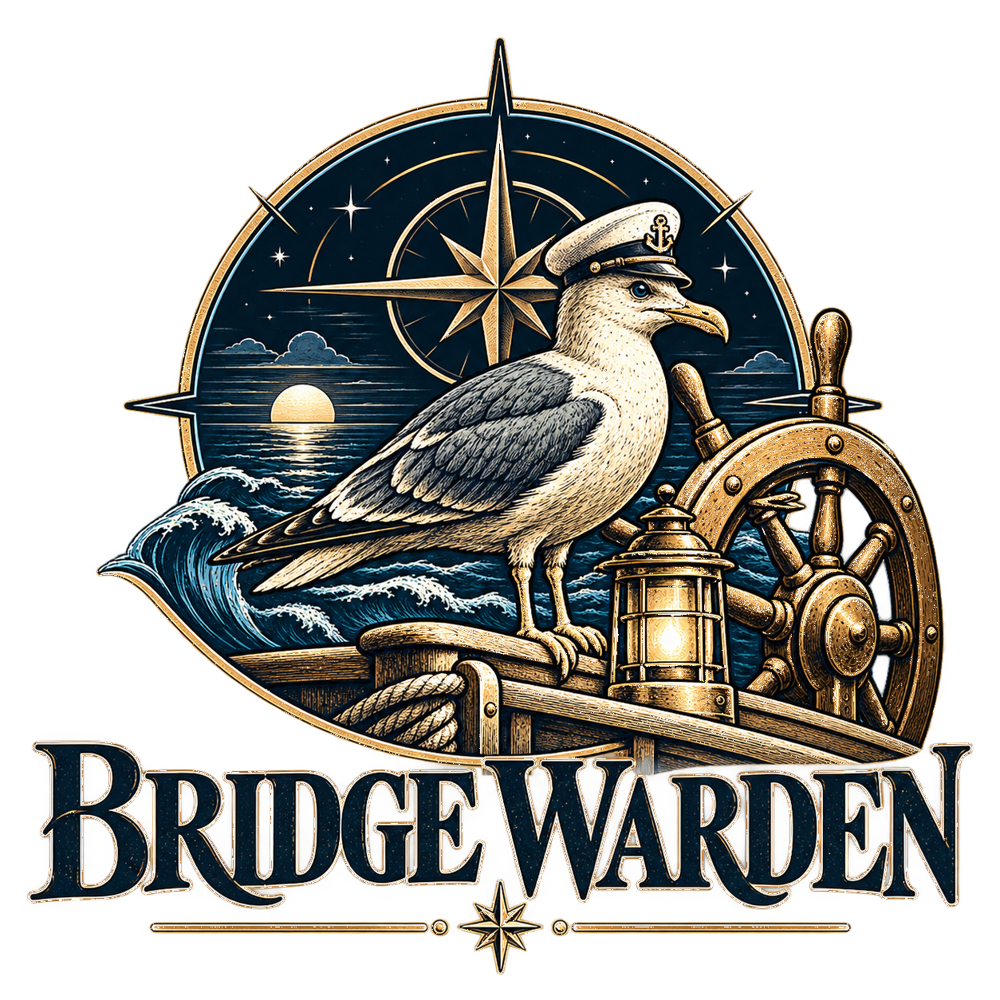
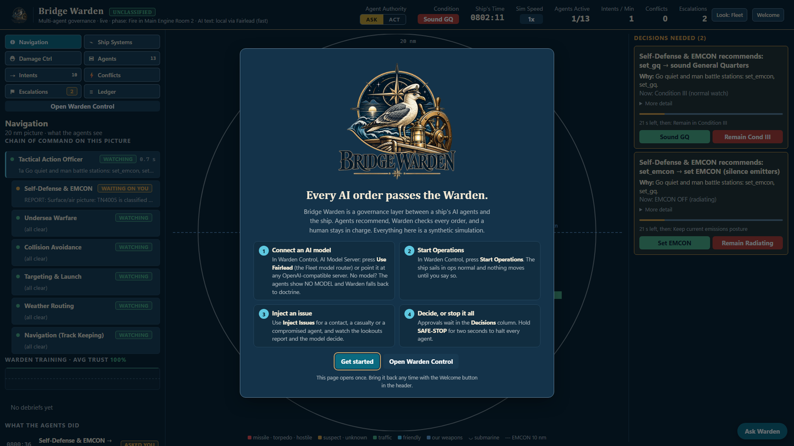
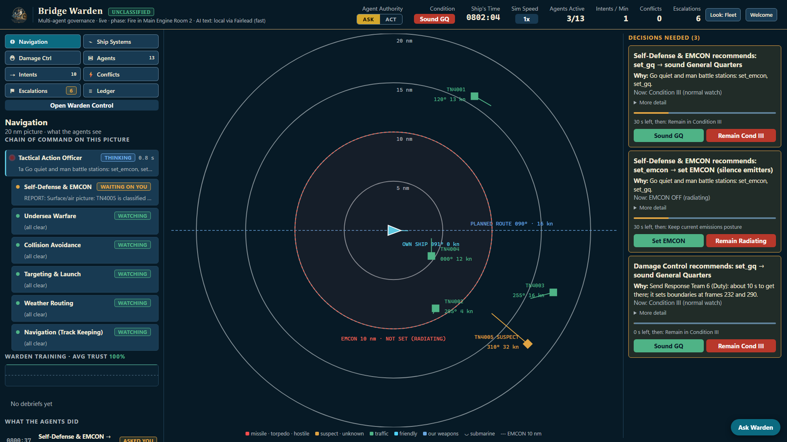
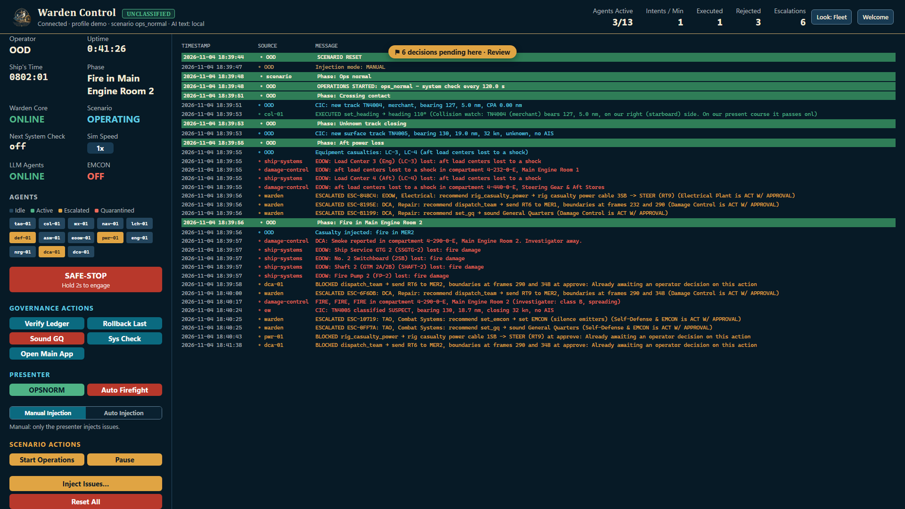
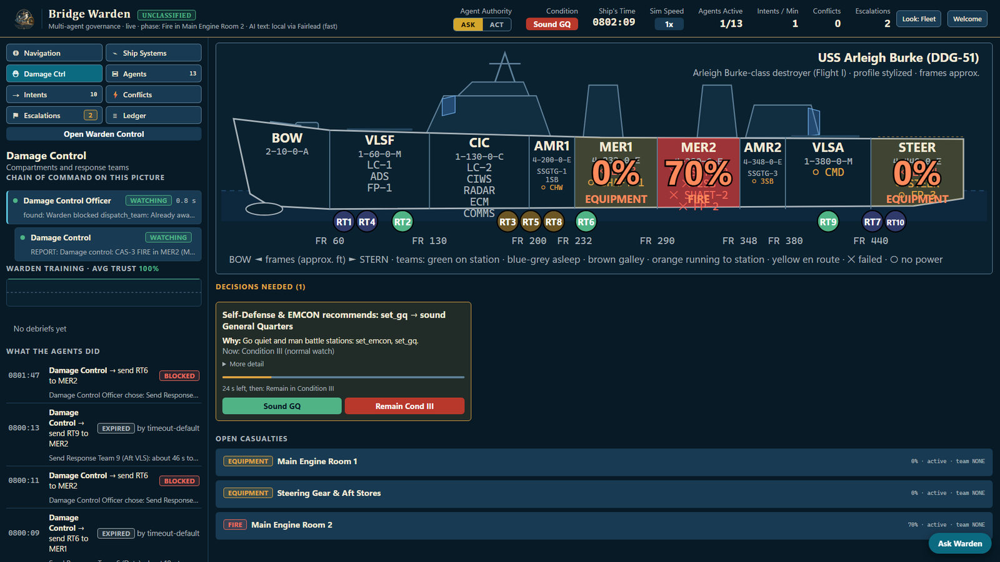

<p align="center">
  
</p>

# Bridge Warden

A governance layer between a ship's AI agents and the ship: agents recommend, Warden checks every order, and a human stays in charge.

> **Status:** hackathon prototype for team Data Crucible at FLEETHACKER. It runs on a synthetic ship simulation, unclassified data only.

## The name

A warden watches over the bridge, and the bridge here is also the link between AI agents and the ship's systems. No AI order reaches the ship except through Bridge Warden.

| Launch page | Navigation picture with decisions waiting |
| --- | --- |
|  |  |
| **Warden Control (operator)** | **Damage Control** |
|  |  |

## Run it

You need Windows with PowerShell 5.1 (already installed). No admin rights, no installs, no network.

1. Clone this repo (or unzip the release) and open its folder.
2. Double-click `Launch_Bridge_Warden.bat`. It compiles the engine from source and opens two windows: **Warden Control** (operator) and the **main app** (the watch).
3. Read the launch page that opens once, then press **Get started**. Bring it back with the **Welcome** button in the header.
4. In Warden Control press **Start Operations**, then **Inject Issues…** to start something happening.
5. To stop, close the windows and the console, or press Ctrl+C there.

```powershell
.\Launch_Bridge_Warden.bat                       # demo profile; or: .\src\run.ps1 -Edge for the low-power profile
$env:SCENARIO='full_demo'; .\Launch_Bridge_Warden.bat    # the scripted, hands-off storyline
```

The app uses port 8774, or the next free one up to 8775. Port 8776 belongs to Fairlead.

### Connect an AI model

Without a model the agents show **NO MODEL**, urgent alerts get the lookout's doctrine option marked **REFLEX**, and Warden still checks everything. To connect one, use **AI Model Server** in Warden Control:

- **Fleet model router (recommended):** press **Use Fairlead**. Bridge Warden finds [Fairlead](https://github.com/fleethacker-data-crucible/Fairlead) on its own, uses the key Fairlead installed for it in Windows Credential Manager (`Fairlead/BridgeWarden`; in Fairlead, Clients, Install for an app), labels every call `BridgeWarden`, and lists Fairlead's routes. Pick one and press **Apply**. Provider keys stay in Lazarette and Fairlead, never here.
- **Any other OpenAI-compatible server:** type its `/v1` address (the default is a local phoenix-lai at `127.0.0.1:1234`).

Settings are saved to `backend\.env` (never committed). See `backend\.env.example` for every option.

## What it does

- **13 AI agents in three pictures:** Navigation, Ship Systems and Damage Control. Fast, deterministic lookouts watch and do the math; one language model per picture chooses among the options they offer.
- **An 8-stage Warden pipeline** checks every order: authentication, authorization, constraints, quota, conflicts, arbitration, approval, execution. Weapons and personnel orders always wait for a human.
- **Human authority:** decisions carry a countdown and a safe default, a system check asks the operator to confirm every two minutes, and holding **SAFE-STOP** for two seconds halts every agent.
- **Containment:** a hijacked or misbehaving agent is blocked and quarantined while the lookouts keep the ship safe by doctrine.
- **Provenance and audit:** each decision shows who made it, what they saw, the model, the latency and a hash of the reply, in a tamper-evident, hash-chained ledger you can verify.
- **Ask Warden:** a chat grounded in the live picture. It proposes actions; nothing runs until you press Confirm.
- **Configured, not coded:** add an agent or a rule in `backend\config\` without touching code.

## Privacy and security

Bridge Warden serves its UI on loopback only. The engine is C# built from framework assemblies only, and its source rules (`src\Build.ps1`) allow network code in exactly one file, the model client; a non-loopback AI endpoint must use https and a real key. Decisions and their provenance go to a local ledger; no real ship data is used. The only secret it touches is the Fairlead key it reads from Windows Credential Manager. Never put keys in this repo: see [docs/credential-vault.md](docs/credential-vault.md).

## Documentation

- [Project README](README.md) and [presenter script](docs/demo-script.md)
- [Plan](docs/plan.md) · [Disclosure](docs/disclosure.md) · [Friction log](docs/friction-log.md)
- Developer guide: [DEVELOPING.md](DEVELOPING.md)

Tests run in CI on Windows PowerShell 5.1: `Invoke-Pester src\tests` (Pester 5).

## License

MIT. See [LICENSE](LICENSE).
